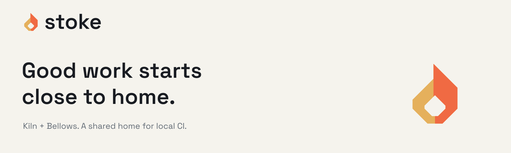

#  stoke



[](https://github.com/smeltery/stoke/actions/workflows/ci.yml)
[](package.json)
[](.flox/env/manifest.toml)
[](LICENSE)

Stoke is the shared workspace for [Kiln](https://github.com/smeltery/kiln) and
[Bellows](https://github.com/smeltery/bellows): a runner environment and a local
workflow orchestrator for GitHub Actions. Clone, set up and update the pair from
one place. Each tool keeps its own repository and releases.

Bellows plans and runs your workflows with act and Docker. Kiln supplies the
Wolfi-based container environment. Together, they bring feedback closer to the
work, before you push. Hosted CI still provides platform coverage and merge
enforcement.

## Quick setup

```sh
git clone https://github.com/smeltery/stoke.git
cd stoke
bash scripts/fleet.sh setup
```

Setup clones the two source repositories; it does not install binaries or start
Docker. See [getting started](docs/getting-started.md) for runtime installation
and your first local workflow.

## Update the workspace

```sh
bash scripts/fleet.sh update
```

Updates fast-forward clean checkouts on `main`. Dirty checkouts, feature branches
and detached HEADs are skipped. See [workspace usage](docs/usage.md).

## The tools

| Logo | Repository | Purpose |
| --- | --- | --- |
|  | [Bellows](https://github.com/smeltery/bellows) | Plan, diagnose and run existing GitHub Actions workflows locally. |
|  | [Kiln](https://github.com/smeltery/kiln) | Supply a Wolfi-based runner image for act, on AMD64 and ARM64. |

[`scripts/repos.txt`](scripts/repos.txt) is the source of truth for membership.
Kiln's Ubuntu-style tags are compatibility aliases; the image runs Wolfi with
`apk`. Local containers do not reproduce every hosted runner feature.

## Inside the workspace

```text
stoke/
├── assets/brand/    # Logos, fonts, tokens, banners and brand guide
├── docs/            # Setup, workflow, configuration and architecture
├── scripts/         # Fleet setup, update, builds and quality checks
├── site/            # Shared landing site, ready for Vercel
├── tests/           # Workspace and site behavior tests
├── kiln/            # Cloned by setup; not tracked here
└── bellows/         # Cloned by setup; not tracked here
```

## Documentation and development

Start with [the documentation index](docs/README.md). The
[development guide](docs/development.md) covers Flox, checks, hooks and the site.
[Brand guidance](assets/brand/README.md) documents the shared identity, reusable
artwork and asset generation. Contributor instructions live in [AGENTS.md](AGENTS.md).

Licensed under [PolyForm Shield 1.0.0](LICENSE).
