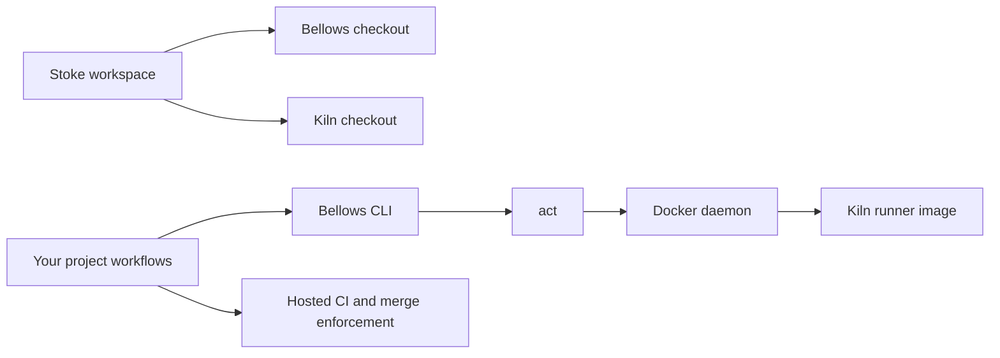

# Architecture

Stoke owns workspace assembly, shared documentation, the landing site and the
family brand. Bellows owns workflow planning and orchestration; Kiln owns the
container environment. The tools retain independent repositories and releases.

Cloning sources is separate from installing the CLI or pulling an image.
`scripts/fleet.sh` reads a manifest and validates existing checkouts before
touching them. There are no Git submodules or combined product releases.

The landing site follows Harbor's layout and interaction patterns. Its workflow
demo is illustrative and executes no commands. Documentation reuses Convrt's
shell, search, mobile navigation and page actions with Stoke's identity.
The build renders Markdown into static HTML at each documentation route and
bundles a React client for interactions. No server or runtime API is required.

The brand library reuses the member palettes, fonts and unmodified member logos.
Stoke's angular flame joins Kiln's gold and Bellows' ember in one family mark.
Owned vector and raster assets are rebuilt by `scripts/build-brand.ts`.
